<!-- ═══════════════════════════  HEADER  ═══════════════════════════ -->

  

  
  &nbsp;&nbsp;
  

  

<!-- ═══════════════════════════  01 · WHOAMI  ═══════════════════════════ -->

  

<!-- ═══════════════════════════  02 · ARSENAL  ═══════════════════════════ -->

<table>
  <tr>
    <td><code>CORE ★</code></td>
    <td>
      
      
      
       lo que más uso hoy en día
    </td>
  </tr>
  <tr>
    <td><code>FRONTEND</code></td>
    <td>
      
      
      
      
      
      
      
    </td>
  </tr>
  <tr>
    <td><code>BACKEND</code></td>
    <td>
      
      
      
    </td>
  </tr>
  <tr>
    <td><code>DATABASES</code></td>
    <td>
      
      
      
      
      
    </td>
  </tr>
  <tr>
    <td><code>DEVOPS</code></td>
    <td>
      
      
      
      
      
    </td>
  </tr>
  <tr>
    <td><code>SECOPS</code></td>
    <td>
      
      
      
      
      
    </td>
  </tr>
</table>

<!-- ═══════════════════════════  03 · SECURITY CLEARANCE  ═══════════════════════════ -->

  

<!-- ═══════════════════════════  04 · SYSTEM DIAGNOSTICS  ═══════════════════════════ -->
<!-- stats.svg y activity.svg se generan cada 6 h con .github/workflows/profile.yml -->

  

  

<!-- ═══════════════════════════  05 · SNAKE PROTOCOL  ═══════════════════════════ -->

  <picture>
    <source media="(prefers-color-scheme: dark)" srcset="https://raw.githubusercontent.com/JsebasGamero/JsebasGamero/output/snake-dark.svg" />
    <source media="(prefers-color-scheme: light)" srcset="https://raw.githubusercontent.com/JsebasGamero/JsebasGamero/output/snake-light.svg" />
    
  </picture>

<!-- ═══════════════════════════  FOOTER  ═══════════════════════════ -->

  

